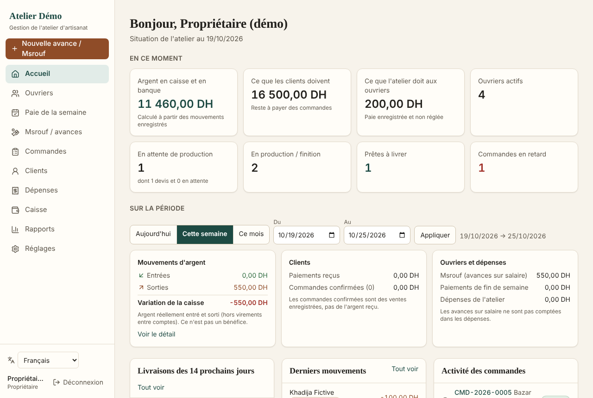
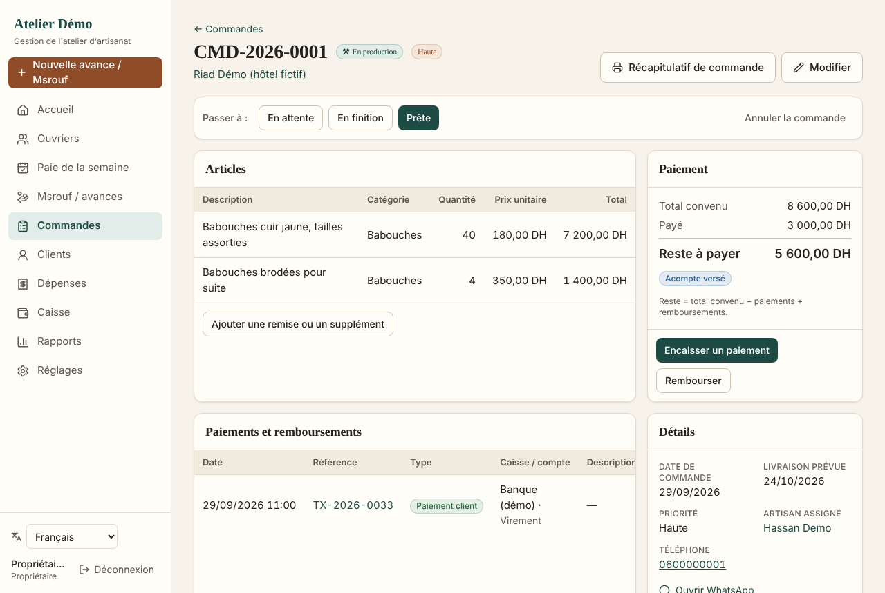
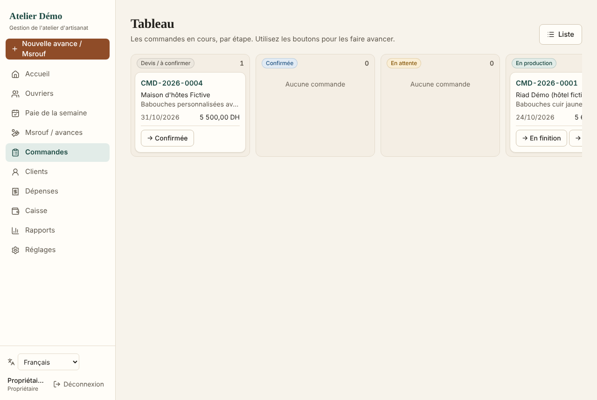

# Atelier — gestion d'un atelier d'artisanat marocain

Internal web application for a small Moroccan handicraft workshop (babouches, cuivre / dinanderie, other
products): workers and their **weekly pay**, **msrouf** (cash advances), customer **orders** with deposits and
partial payments, **expenses**, a single immutable **cash ledger**, **reports**, CSV export and printable
receipts. French (default), **Moroccan Arabic (right-to-left)**, English and Spanish.

It is a management tool, not an e-commerce site, ERP or certified accounting/payroll software.

| Dashboard | Weekly pay | Order |
|---|---|---|
|  |  |  |

| Msrouf on a phone | Arabic (RTL) on a phone | Orders board |
|---|---|---|
|  |  |  |

*(Screenshots use fictional demo data.)*

## Features

- **Dashboard**: cash in bank/boxes, what customers owe, what is owed to workers, orders by stage, overdue
  orders, period figures (today / week / month / custom) that link to the detailed lists; cash movement, recorded
  sales, receivables, worker liabilities and expenses are always shown separately — never as "profit".
- **Workers**: directory (search, filters, sort, pagination), profile with balance, weeks, transactions,
  configurable pay (weekly, daily, piece-rate, negotiated) with history; deactivation keeps history.
- **Weekly pay**: one sheet per week with agreed pay, msrouf, payments and remaining for every worker; partial
  payments; bonuses/corrections; carry-forward to next week; printable receipts and weekly report.
  *Remaining = agreed pay + adjustments − wage advances of the week − payments of the week.*
- **Msrouf**: fast entry (worker, amount, done), categories, wage advance vs. workshop purchase, week allocation,
  optional order and attachment; list with totals and filters.
- **Orders**: line items, deposit at creation, statuses Devis → Confirmée → En attente → En production →
  En finition → Prête → Livrée / Annulée with dated history, Kanban board, overdue markers, documented discounts,
  payments, refunds, cancellation with retained amount, photos/documents, printable summary.
- **Customers**: balances, orders, payments, duplicate warnings, WhatsApp click-to-chat (nothing automatic).
- **Expenses & cash**: categories, several cash boxes/bank accounts, opening balances, transfers, other income,
  cash counts with explicit audited adjustments; full journal; reversals instead of edits or deletions.
- **Reports** (13) with an explanation of each calculation, CSV export (UTF-8 BOM, `;`, decimal comma) and print.
- **Security**: owner / manager roles enforced on the server *and* by PostgreSQL Row Level Security, audit log,
  login throttling, idempotent writes, private uploads. See [docs/security.md](docs/security.md).

## Stack

Next.js 16 (App Router, Server Actions) · React 19 · TypeScript (strict) · Tailwind CSS 4 · Zod 4 ·
PostgreSQL 16 (works on Supabase) with RLS · `postgres` driver · Vitest · Playwright + axe-core · ESLint ·
GitHub Actions.

## Run locally

Requirements: Node.js 22+, PostgreSQL 15+.

```bash
npm ci
createdb atelier_dev
cp .env.example .env.local          # then fill in real local values
# Apply migrations (creates schema `atelier` and the restricted role `atelier_app`)
MIGRATION_DATABASE_URL=postgres://postgres:<pw>@localhost:5432/atelier_dev APP_DB_PASSWORD=<app pw> npm run db:migrate
# Either create your owner account…
MIGRATION_DATABASE_URL=… OWNER_EMAIL=you@example.com OWNER_NAME="Votre nom" npm run db:create-owner
# …or load fictional demo data (dev only; logins demo.owner@example.com / demo.manager@example.com)
MIGRATION_DATABASE_URL=… DEMO_PASSWORD=<at least 10 chars> npm run db:seed
npm run dev                          # http://localhost:3000
```

`.env.local` needs at least `DATABASE_URL=postgres://atelier_app:<app pw>@localhost:5432/atelier_dev`.

## Commands

| Command | Purpose |
|---|---|
| `npm run dev` / `npm run build` / `npm start` | Develop, build, serve the production build |
| `npm run lint` · `npm run typecheck` | ESLint · TypeScript |
| `npm run test:unit` · `npm run test:integration` · `npm test` | Vitest (integration needs PostgreSQL) |
| `npm run test:e2e` | Playwright scenarios A–F (after `npm run build`) |
| `npm run i18n:check` | Every text exists in fr / ar / en / es with the same placeholders |
| `npm run db:migrate` · `npm run db:create-owner` · `npm run db:seed` | Database scripts |

## Documentation

- [docs/research.md](docs/research.md) — verified facts, assumptions, points to confirm with a professional
- [docs/architecture.md](docs/architecture.md) — layers and request flow
- [docs/database.md](docs/database.md) — model, ledger rules and balance formulas
- [docs/testing.md](docs/testing.md) — test suites and scenarios
- [docs/deployment.md](docs/deployment.md) — Supabase/Vercel or VPS, backup, restore, rollback
- [docs/security.md](docs/security.md) — authentication, permissions, secrets, privacy
- [docs/progress.md](docs/progress.md) — status, results, blockers

## Disclaimer

Printed receipts are internal documents, not pay slips or invoices. The app does not compute legal deductions,
social contributions or taxes; see `docs/research.md` for points to confirm with an accountant.
