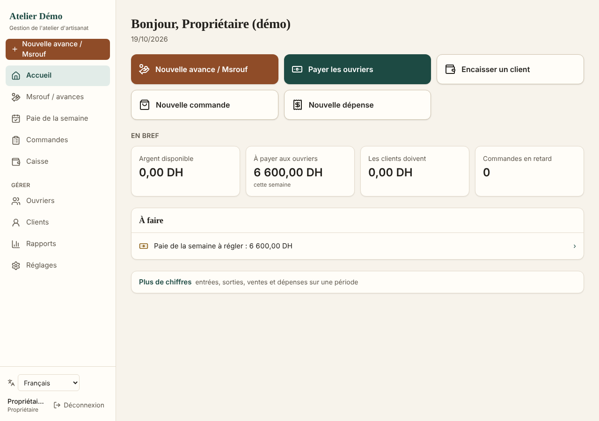
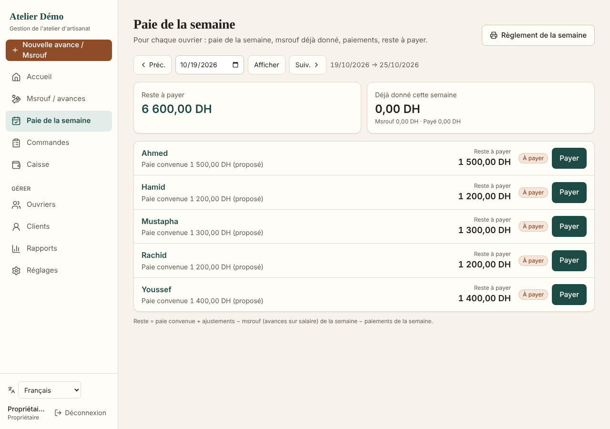
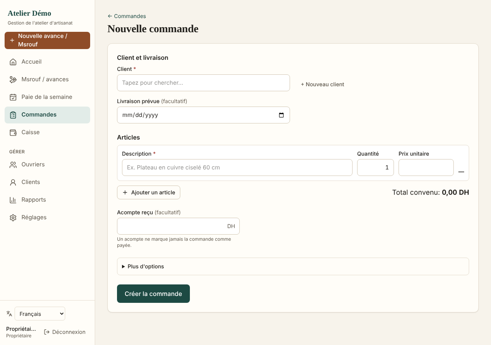
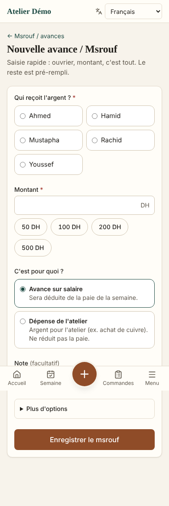
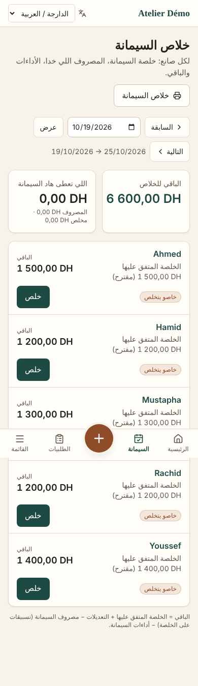
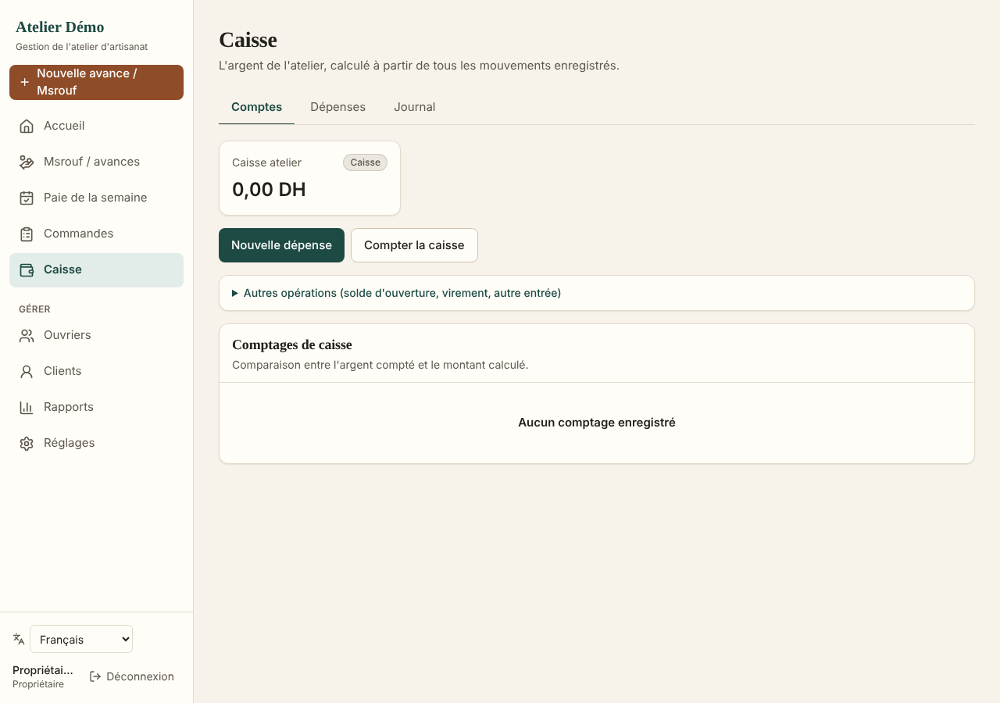

# Atelier — gestion d'un atelier d'artisanat marocain

Internal web application for a small Moroccan handicraft workshop (babouches, cuivre / dinanderie, other
products): workers and their **weekly pay**, **msrouf** (cash advances), customer **orders** with deposits and
partial payments, **expenses**, a single immutable **cash ledger**, **reports**, CSV export and printable
receipts. French (default), **Moroccan Arabic (right-to-left)**, English and Spanish.

It is a management tool, not an e-commerce site, ERP or certified accounting/payroll software.

| Home | Weekly pay | New order |
|---|---|---|
|  |  |  |

| Msrouf on a phone | Arabic (RTL) on a phone | Cash |
|---|---|---|
|  |  |  |

*(Screenshots use fictional demo data.)*

## Features

**Designed to stay simple.** The home screen has big buttons for daily tasks (give a msrouf, pay the week,
collect from a customer, new order, new expense), four key numbers and a short "À faire" list. Forms show only
the essential fields; dates, accounts, payment methods and other details are pre-filled and folded under
"Plus d'options". Lists show a search box, with filters folded away. Rarely used owner tools (opening balance,
transfers, other income) are grouped under "Autres opérations" in Caisse.

**Products are configurable.** The workshop starts with **Cuivre / dinanderie** only. Babouches (built in) can
be switched on, and new categories added, in **Réglages → Catégories de produits**, with no code change. When
only one category is active, the category fields disappear from the forms.

- **Dashboard**: cash in bank/boxes, what customers owe, what is owed to workers, orders by stage, overdue
  orders, period figures (today / week / month / custom) that link to the detailed lists; cash movement, recorded
  sales, receivables, worker liabilities and expenses are always shown separately — never as "profit".
- **Workers**: directory (search, filters, sort, pagination), profile with balance, weeks, transactions,
  configurable pay (weekly, daily, piece-rate, negotiated) with history; deactivation keeps history.
- **Weekly pay**: one sheet per week with agreed pay, msrouf, payments and remaining for every worker; partial
  payments; bonuses/corrections; carry-forward to next week; printable receipts and weekly report.
  *Remaining = agreed pay + adjustments − wage advances of the week − payments of the week.*
- **Msrouf**: fast entry (worker, amount, done), categories, wage advance vs. workshop purchase, week allocation,
  optional order and attachment; list with totals and filters.
- **Orders**: line items, deposit at creation, statuses Devis → Confirmée → En attente → En production →
  En finition → Prête → Livrée / Annulée with dated history, Kanban board, overdue markers, documented discounts,
  payments, refunds, cancellation with retained amount, photos/documents, printable summary.
- **Customers**: balances, orders, payments, duplicate warnings, WhatsApp click-to-chat (nothing automatic).
- **Expenses & cash**: categories, several cash boxes/bank accounts, opening balances, transfers, other income,
  cash counts with explicit audited adjustments; full journal; reversals instead of edits or deletions.
- **Reports** (13) with an explanation of each calculation, CSV export (UTF-8 BOM, `;`, decimal comma) and print.
- **Security**: owner / manager roles enforced on the server *and* by PostgreSQL Row Level Security, audit log,
  login throttling, idempotent writes, private uploads. See [docs/security.md](docs/security.md).

## Stack

Next.js 16 (App Router, Server Actions) · React 19 · TypeScript (strict) · Tailwind CSS 4 · Zod 4 ·
PostgreSQL 16 (works on Supabase) with RLS · `postgres` driver · Vitest · Playwright + axe-core · ESLint ·
GitHub Actions.

## Run locally

You need **Node.js 22+**, **Git** and a **PostgreSQL 15+ database**. The database can be on your PC, or a free
online one (Neon or Supabase). The app works the same with either.

> **No account exists out of the box.** You create the first login yourself (step 4): either the demo accounts
> or your own owner account.

### 1. Get the code

```bash
git clone https://github.com/mehdiaichouch2002/atelier-artisanat.git
cd atelier-artisanat
npm ci
```

`npm ci` may print warnings: `eslint … deprecated`, `5 high severity vulnerabilities` and
`unrs-resolver … install scripts`. They come from developer tools (lint/tests), not from the app. Do **not**
run `npm audit fix --force`.

### 2. Get a database: pick one

**Option A: free online database on Neon (easiest on Windows, nothing to install)**

1. Sign up at https://neon.tech and create a project (pick a region near you, e.g. Europe/Frankfurt).
2. In the project, open **Connect**, role `neondb_owner`, database `neondb`. You need two addresses:
   - the **direct** address: switch **Connection pooling off**, so the host has **no** `-pooler`. Used for
     setup (step 3).
   - the **pooled** address: switch **Connection pooling on**, so the host contains `-pooler`. Used by the
     app (step 5).
3. Copy with the copy button (the screen shows `****` instead of the password).
4. **Delete `&channel_binding=require`** from the end of the copied address. The app's database driver does not
   support that option. The address must end with `?sslmode=require`.
5. Never paste these addresses (they contain passwords) into chats, issues or commits. If one leaks, use
   **Reset password** on the role in Neon.

You do not need to create a database: Neon already provides `neondb`.

**Option B: PostgreSQL on your PC**

- Windows/macOS installer: https://www.postgresql.org/download/; Homebrew: `brew install postgresql@16`;
  Ubuntu: `sudo apt install postgresql`.
- Create the database: `psql -U postgres -c "create database atelier_dev"`.
- Your setup address is then `postgres://postgres:<postgres password>@localhost:5432/atelier_dev`.
- On Windows, if `psql` is "not recognised", use
  `& "C:\Program Files\PostgreSQL\16\bin\psql.exe" …` or create the database in pgAdmin.
- On Windows 11, **Smart App Control** may block parts of the PostgreSQL installer. It cannot allow a single
  program, and turning it off cannot be undone without resetting Windows, so use Option A instead.

### 3. Create the tables (migrations)

This creates the `atelier` schema and a restricted database user **`atelier_app`** that the app connects with.
Choose its password in `APP_DB_PASSWORD`, using only letters, digits and `-` (characters such as `@ : / #`
break connection addresses).

macOS / Linux:
```bash
export MIGRATION_DATABASE_URL='<direct address from step 2>'
export APP_DB_PASSWORD='Choose-A-Long-Password-2026'
npm run db:migrate
```

Windows PowerShell:
```powershell
$env:MIGRATION_DATABASE_URL="<direct address from step 2>"
$env:APP_DB_PASSWORD="Choose-A-Long-Password-2026"
npm run db:migrate
```

Expected output ends with `migrations up to date`. Running it again is safe.

### 4. Create a login and starting data (same terminal window)

- **Simple starting data (recommended): 5 copperwork workers, nothing paid.** `npm run db:seed` creates 5
  workers (Ahmed, Youssef, Mustapha, Rachid, Hamid; weekly pay 1 200–1 500 DH, editable) with **no msrouf, no
  payments, no orders and no expenses**. With `DEMO_PASSWORD` it also creates the demo logins:
  ```powershell
  $env:DEMO_PASSWORD="demo-password-123"      # bash: export DEMO_PASSWORD='demo-password-123'
  npm run db:seed
  ```
  Expected: `5 copper workers created (weekly pay, no money movements).` Logins: **`demo.owner@example.com`**
  (owner) and **`demo.manager@example.com`** (manager), both with your `DEMO_PASSWORD`.
- **Your own owner account** (asks for a password of 10+ characters):
  ```powershell
  $env:OWNER_EMAIL="you@example.com"
  $env:OWNER_NAME="Your name"
  npm run db:create-owner
  ```
  Expected: `owner ready: you@example.com`. Running it again with the same e-mail **resets that password**,
  which helps if you forget it. `npm run db:seed` without `DEMO_PASSWORD` then adds the 5 workers to your account.
- **Start again from a clean workshop:** `npm run db:reset` erases all workers, msrouf, payments, orders,
  customers, expenses and cash movements. It keeps user accounts and settings, and asks you to type
  `EFFACER` first. Then run `npm run db:seed` again. Use it only on test data or before real use.
- **Rich demo** (several weeks of history, orders, expenses, babouches + cuivre): `npm run db:seed:full`, on an
  empty database only.

- **Super administrator.** Only one account, the super administrator, can add, edit or deactivate users and
  reset their passwords. Give that role to your own owner account by adding `-- --super-admin`:
  ```powershell
  $env:OWNER_EMAIL="you@example.com"
  $env:OWNER_NAME="Your name"
  npm run db:create-owner -- --super-admin
  ```
  Expected: `super administrator: you@example.com`. Running it with another e-mail moves the role to that
  account. Without a super administrator, nobody can manage users in the app.

The super administrator adds the other people (as **Gérant** or **Propriétaire**) in the app under
**Réglages → Utilisateurs**.

### 5. Configure the app: `.env.local`

Create a file named exactly `.env.local` in the project folder. It is **not** a command, so don't type these
lines into the terminal. The address is the one from step 2 with the user and password changed to
`atelier_app` and your `APP_DB_PASSWORD`.

Online database (Neon, pooled address):
```
DATABASE_URL=postgresql://atelier_app:<APP_DB_PASSWORD>@<host-with--pooler>/neondb?sslmode=require
DATABASE_SSL=true
DATABASE_PREPARE=false
```

Local database:
```
DATABASE_URL=postgres://atelier_app:<APP_DB_PASSWORD>@localhost:5432/atelier_dev
DATABASE_SSL=false
```

On Windows, create the file from PowerShell so it is saved without a byte-order mark. Notepad may add one,
which breaks the first line, or save the file as `.env.local.txt`:
```powershell
$lines = @(
  "DATABASE_URL=postgresql://atelier_app:<APP_DB_PASSWORD>@<host-with--pooler>/neondb?sslmode=require",
  "DATABASE_SSL=true",
  "DATABASE_PREPARE=false"
)
[IO.File]::WriteAllLines("$PWD\.env.local", $lines, (New-Object Text.UTF8Encoding $false))
Get-Content .env.local
```

`.env.local` is git-ignored: it never goes to GitHub. The `npm run db:*` scripts do not read it, which is
why steps 3–4 set their variables on the command line.

### 6. Start

```bash
npm run dev            # http://localhost:3000   (another port: npm run dev -- -p 3001)
```

To run it like production: `npm run build` then `npm start`.

### Look at the data (optional)

- **Neon**: open the project, then **SQL Editor**. If the menu doesn't show it, use the console search
  (**Ctrl K → "SQL Editor"**) or the `⋮` menu of the compute. Select branch `production`, database `neondb`.
  The **Tables** view needs schema **`atelier`** (not `public`).
- **Local**: `psql "<direct address>"`, then `set search_path to atelier;`.

All tables live in the `atelier` schema and amounts are stored in **centimes** (divide by 100):

```sql
select email, display_name, role, active from atelier.users;
select name, balance_cents / 100.0 as dh from atelier.v_account_balances;
select reference, entry_type, direction, amount_cents / 100.0 as dh, occurred_at
  from atelier.ledger_entries order by occurred_at desc limit 20;
```

Use the SQL editor for reading only and make changes in the app. Money movements are locked by design: the
database refuses edits and deletions, and corrections are made with **Annuler ce mouvement**.

### Troubleshooting

| Message | Fix |
|---|---|
| Windows: `npm.ps1 … l'exécution de scripts est désactivée` | `Set-ExecutionPolicy -Scope CurrentUser -ExecutionPolicy RemoteSigned`, then reopen PowerShell (or type `npm.cmd` instead of `npm`). |
| `psql` is not recognised | PostgreSQL is not installed or not on PATH; see step 2. |
| `password authentication failed for user 'neondb_owner'` / `'postgres'` | Wrong password in `MIGRATION_DATABASE_URL`. Copy it again from Neon (copy button), or reset the role's password. |
| `password authentication failed for user "atelier_app"` | The password in `.env.local` differs from `APP_DB_PASSWORD`. Run step 3 again with the right one; it only resets that password. |
| `unrecognized configuration parameter "channel_binding"` | Remove `&channel_binding=require` from the address. |
| `permission denied to create role` | Step 3 must use the database owner (`neondb_owner` / `postgres`), not `atelier_app`. |
| `Workers already exist` / `The database already contains data` (seed) | Seeds only run on an empty workshop: run `npm run db:reset` first (erases business data). |
| `DATABASE_URL is not set` when starting the app | `.env.local` is missing, misnamed (`.env.local.txt`) or saved with a byte-order mark; recreate it as in step 5. |
| Sign-in refused | No account yet (do step 4) or wrong password (re-run `db:create-owner` with the same e-mail). |
| `Trop de tentatives` | 5 failed sign-ins in 15 minutes. Wait 15 minutes, or run `npm run db:create-owner` (it resets that password and lifts all login locks), or run `delete from atelier.login_attempts where not success;` in the database SQL editor. |

## Commands

| Command | Purpose |
|---|---|
| `npm run dev` / `npm run build` / `npm start` | Develop, build, serve the production build |
| `npm run lint` · `npm run typecheck` | ESLint · TypeScript |
| `npm run test:unit` · `npm run test:integration` · `npm test` | Vitest (integration needs PostgreSQL) |
| `npm run test:e2e` | Playwright scenarios A–F (after `npm run build`) |
| `npm run i18n:check` | Every text exists in fr / ar / en / es with the same placeholders |
| `npm run db:migrate` · `npm run db:create-owner` | Create/update the schema · create or reset an owner login |
| `npm run db:seed` · `npm run db:reset` · `npm run db:seed:full` | 5 copper workers with no money · erase business data (asks to confirm) · rich demo history |

## Documentation

- [docs/research.md](docs/research.md) — verified facts, assumptions, points to confirm with a professional
- [docs/architecture.md](docs/architecture.md) — layers and request flow
- [docs/database.md](docs/database.md) — model, ledger rules and balance formulas
- [docs/testing.md](docs/testing.md) — test suites and scenarios
- [docs/deployment.md](docs/deployment.md) — Supabase/Vercel or VPS, backup, restore, rollback
- [docs/security.md](docs/security.md) — authentication, permissions, secrets, privacy
- [docs/progress.md](docs/progress.md) — status, results, blockers

## Disclaimer

Printed receipts are internal documents, not pay slips or invoices. The app does not compute legal deductions,
social contributions or taxes; see `docs/research.md` for points to confirm with an accountant.
